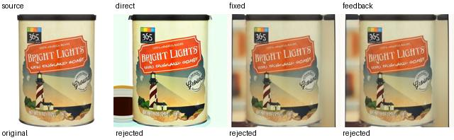

# Replayable image editing agent

Compare a direct image edit, a fixed two-attempt workflow and a feedback policy that may stop after the first attempt. Each task can be audited from the original product image through the ComfyUI request, output hash and acceptance decision.



With the environment, server and weights prepared below, the shortest local demo is `python src/local_server.py demo --source .cache/ComfyUI --model-dir .cache/sd15 --device cpu`.

## Reproduce

Use Python 3.11. For CUDA runs install matching PyTorch 2.4.1 and torchvision 0.19.1 CUDA wheels first. CPU and CUDA outputs can differ. Our reported run used CPU with OMP_NUM_THREADS=4 and MKL_NUM_THREADS=4. The launcher binds a temporary server to localhost and stops it after the run.

```sh
python -m pip install -r requirements-comfy-api.txt
git clone --depth 1 --branch v0.3.12 https://github.com/Comfy-Org/ComfyUI.git .cache/ComfyUI
python src/fetch_sd15.py --output .cache/sd15
python -m unittest discover -s tests
python src/local_server.py probe --source .cache/ComfyUI
python src/local_server.py demo --source .cache/ComfyUI --model-dir .cache/sd15 --device cpu
python src/local_server.py reproduce --source .cache/ComfyUI --model-dir .cache/sd15 --device cpu
python run.py evaluate --output results/formal
python run.py replay --trace results/formal/B074H6ZXT5-normal/feedback/trace.json
```

To use an already running server, use `python run.py demo --checkpoint diffusers:sd15`. Specify `--url` if the server uses a different port. See [the fixed model manifest](results/formal/model-manifest.json) for the three verified weights. The model is the four-channel SD1.5 base with masked latent sampling.

## Measured results

Two held-out products were evaluated under three conditions for each policy, yielding 18 complete traces. Each policy has at most two render attempts. Direct editing uses one. Fixed editing always attempts two, while feedback chooses whether to retry after scoring the first image. A render attempt can fail before a prediction exists.

| Condition (two tasks per policy) | Direct | Fixed | Feedback |
|---|---:|---:|---:|
| Normal inputs, images generated | 2/2 | 2/2 | 2/2 |
| Normal inputs passing both criteria | 0/2 | 0/2 | 0/2 |
| Bad masks rejected before any render | 2/2 | 2/2 | 2/2 |
| First tool call fails, image recovered | 0/2 | 2/2 | 2/2 |

The predeclared acceptance checks require a foreground mean absolute pixel error at most 18/255 and red-dominant pixels on at least 35% of the background. For the coffee tin, the second seed improved red coverage from 9.4% to 29.2% and reduced foreground error from 19.70 to 11.63, still below the background criterion. The two-attempt policies handled the injected tool faults but neither produced an accepted edit on this small test. Rejection remains a valid terminal decision. [Per-task scores](results/formal/scores.csv) · [Aggregate results](results/formal/summary.json) · [Fault case](results/formal/injected-failure.jpg)

## Architecture

- `src/data.py` loads four SHA-256-checked public product images and masks exported by P01. Two products are held out. The compact bundle in `examples/products/` works offline and its license is recorded in [data.md](data.md).
- `src/comfy.py` uploads the alpha-masked input, submits native ComfyUI inpainting nodes, polls the queue and downloads the prediction. The server can cache identical graph results. Reported attempts count issued editing tool calls, including injected faults.
- `src/agent.py` validates input masks, scores the unchanged and edited regions, limits retries and records a trace. Offline replay checks input/output hashes, attempt sequence, graph seed, selected prediction and final decision.
- `tests/check_live_server.py` independently checks the live HTTP upload and download path. The real 384×384 mask round-trip had zero changed pixels. [Probe results](results/probe/protocol.json)

Sources and model terms are in [UPSTREAM.md](UPSTREAM.md). Current handoff and any outstanding work are in [HANDOFF.md](HANDOFF.md).

